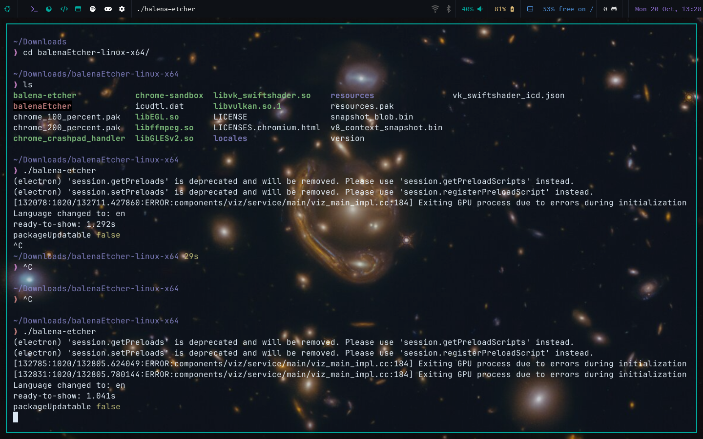
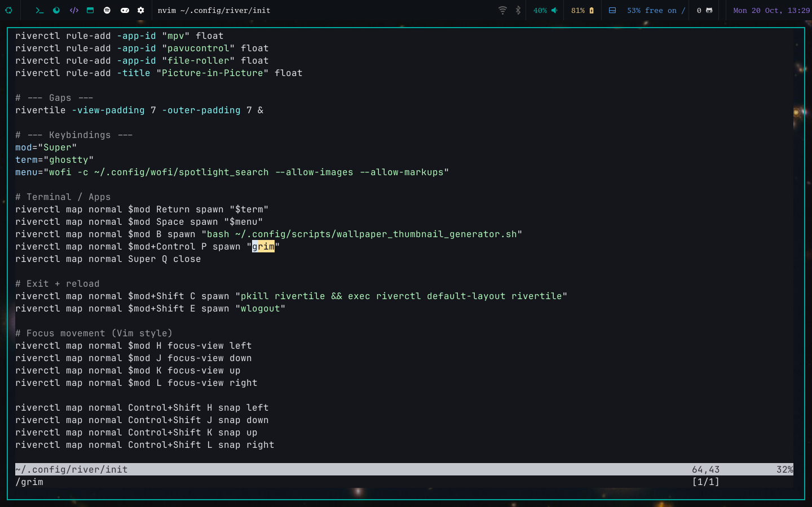
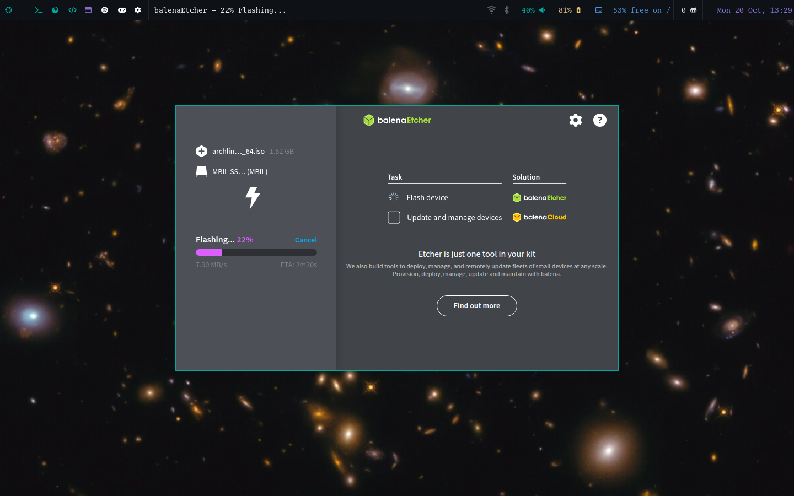
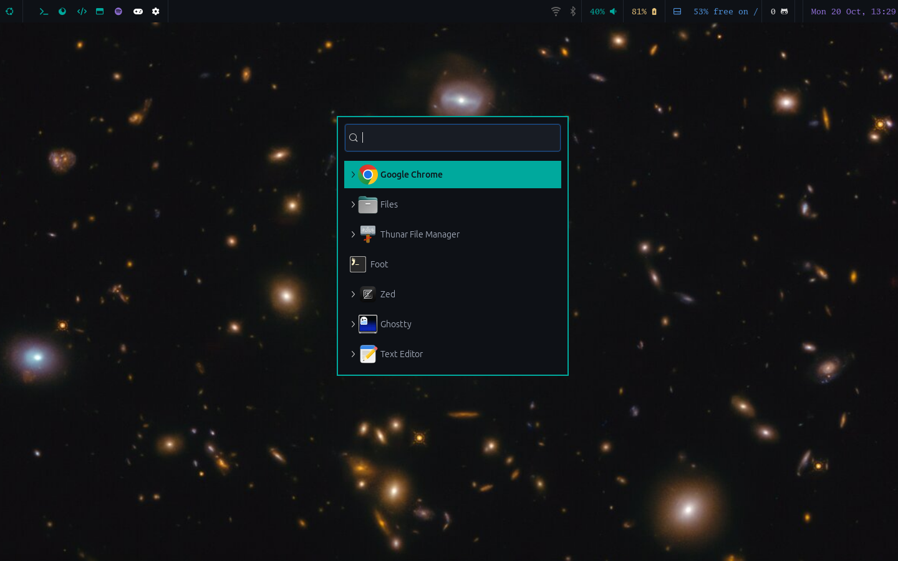
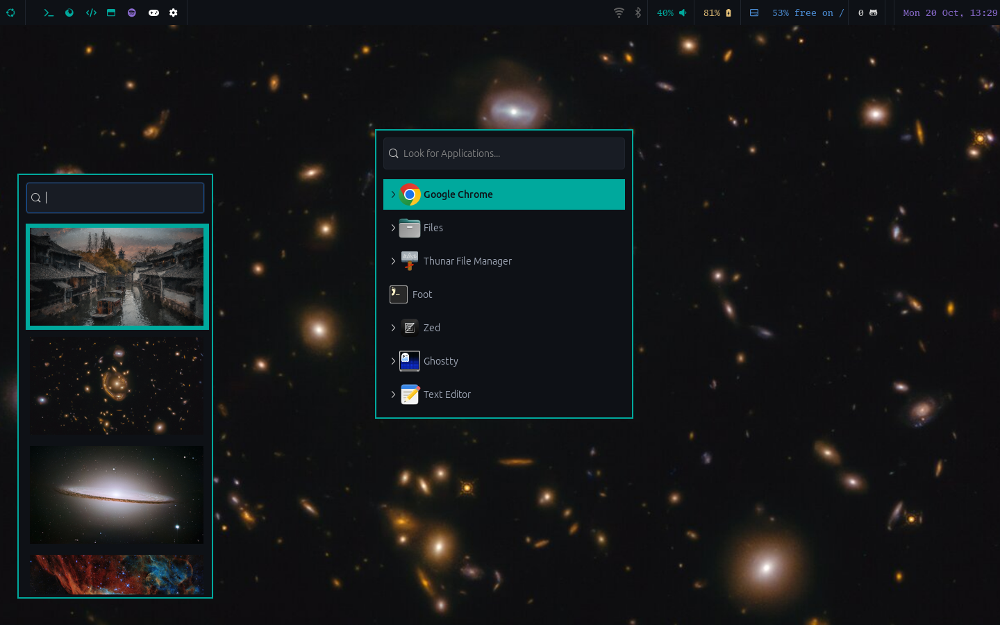

## To Whom It May Concern

🐧✨ These are my **dotfiles**, a collection of questionable decisions that somehow led me to the right decision — **Arch Linux** 🐧✨

---

### 🧠 Features? (maybe)
- [x] A **Rofi** script to change wallpapers
- [x] A **Rofi** script for volume and brightness
- [x] And a bunch of other scripts — check the `scripts/` folder

---

> “River was very nice. Simple. Easy...
> Have a look at the framebuffer thingy that doesnt let your window go out of the screen bounds!!!
> but Ubuntu? hmmmmm”

---

### 📸 Screenshots

| Setup Preview | |
|----------------|--|
|  |  |
|  |  |
|  |   |

---

🖼️ **Wallpapers?**
They’re in ./walls/

---

**Tools Used**
| Tools | Need |
| Wofi | App launcher and stuff |
| Waybar | Status bar |
| ghostty | Terminal emulator |
| riverwm | Window manager |

'''
Ill update more if i remember more
```

Thanks for visiting!
